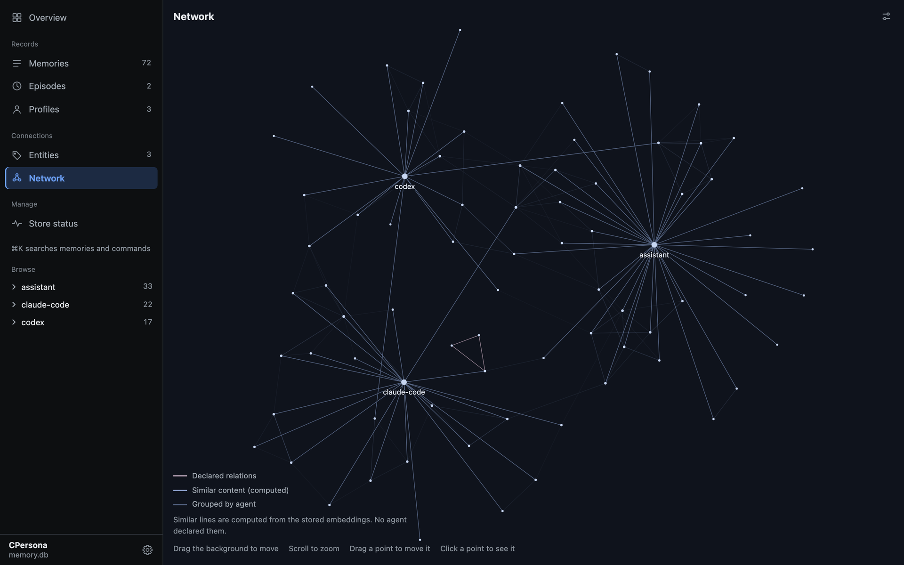
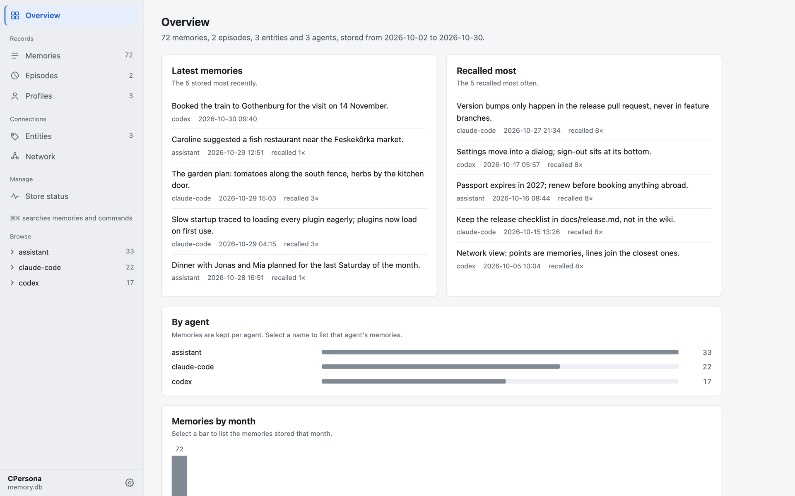
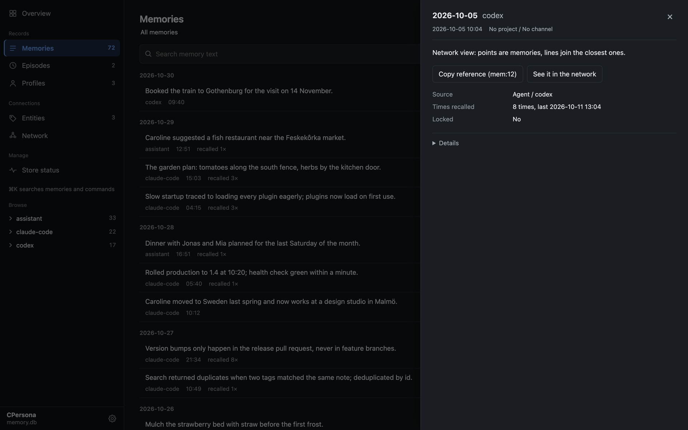

<!-- mcp-name: io.github.Cloto-dev/cpersona -->

<div align="center">

# CPersona

**Long-term memory for AI agents, in one SQLite file you own.**

CPersona is an [MCP](https://modelcontextprotocol.io/) server that lets Claude Code, Codex, Claude Desktop, Cursor, VS Code
or any other MCP client remember what you decided, why, and what happened last time — across sessions.

[](https://pypi.org/project/cpersona/) [](https://github.com/Cloto-dev/cpersona/actions/workflows/ci.yml) [](https://github.com/Cloto-dev/cpersona/blob/master/pyproject.toml) [](https://github.com/Cloto-dev/cpersona/blob/master/LICENSE)

[Documentation](https://cloto-dev.github.io/CPersona/) · [Getting Started](https://cloto-dev.github.io/CPersona/getting-started/) · [Tools](https://cloto-dev.github.io/CPersona/tools/) · [Discussions](https://github.com/Cloto-dev/cpersona/discussions)



<sub>The built-in dashboard, showing a made-up store of 72 memories.</sub>

</div>

## Why CPersona

Every new session with a coding agent starts from zero. CPersona gives the agent a memory it
can write to as it works and read from before it acts.

- **Yours, on your machine.** Everything lives in a single SQLite file. No account, no cloud,
  no external database; `sqlite3 .backup` copies it.
- **No language model inside.** CPersona never calls a generative model to store or recall.
  Your agent writes the summary; CPersona keeps it and finds it again.
- **Answers you can trace.** `reconstruct`, the recommended way to answer from memory, quotes the
  stored records behind each item, so you can see where an answer came from.
- **Search that catches what vectors miss.** Vector search runs beside full-text and keyword
  search, so exact names, identifiers and error strings are found too, in Japanese and other
  scripts without spaces as well.
- **See what it remembers.** `cpersona dashboard` opens a read-only page of the store: what was
  stored last, what is recalled most, every memory in full, and the network above.
- **Honest when it degrades.** Without an embedding server it still runs on keyword search, and
  says so on every recall instead of quietly returning less.

## Quick start

**With Claude Code or Codex**, install the agent plugin and let the agent do the rest:

```text
/plugin install cpersona --marketplace Cloto-dev/cpersona
```

Then say *"Set up CPersona."* The plugin carries the setup skill and the hooks that remind the
agent to recall before it acts and to store as it goes. (Claude Code 2.1.275 or later. In Codex:
`codex plugin marketplace add Cloto-dev/cpersona`, then `codex plugin add cpersona@cpersona`.)

**By hand**, in three steps:

```bash
# 1. Run an embedding server (recommended; it powers vector search)
uvx --from "cembedding[onnx]" cembedding-download-model --model bge-m3
EMBEDDING_PROVIDER=onnx_bge_m3 uvx --from "cembedding[onnx]" cembedding

# 2. Register CPersona with your client (Claude Code shown)
claude mcp add-json cpersona '{"type":"stdio","command":"uvx","args":["cpersona"],"env":{"CPERSONA_DB_PATH":"/home/you/.claude/cpersona.db","EMBEDDING_MODE":"http","EMBEDDING_HTTP_URL":"http://127.0.0.1:8401/embed"}}' -s user

# 3. In a new session, ask the agent to store something, then recall it in another new session

# 4. See what it remembers, in the browser
cpersona dashboard
```

[Getting Started](https://cloto-dev.github.io/CPersona/getting-started/) covers the other clients,
Windows, containers, and the short policy block that makes every future session use the memory.

Upgrading an existing install? Read the *When you upgrade* section of the
[release notes](https://github.com/Cloto-dev/cpersona/releases) and
[SUPPORT.md](https://github.com/Cloto-dev/cpersona/blob/master/SUPPORT.md) first.

## A look inside

| Overview | A memory, opened |
| --- | --- |
|  |  |

Memories are kept per agent, and `project_id` and `channel` let several agents and projects share
one database without mixing.

## Benchmarks

On [OmniMemEval](https://github.com/MemTensor/OmniMemEval)'s LongMemEval-S pipeline (500 questions,
answered by `gpt-4.1-mini`, judged by `gpt-4o-mini`), in this project's own run. Overall is the
share of questions judged correct; Context Tokens is the average sent to the answer model per question:

| Backend | Deployment | SS-User | SS-Asst | SS-Pref | Temp. Reas | Multi-S | Know. Upd | Overall | Context Tokens |
| --- | --- | ---: | ---: | ---: | ---: | ---: | ---: | ---: | ---: |
| CPersona 2.6.11 (pro mode) | local | 97.14 | 94.64 | 96.67 | 86.47 | 85.71 | 88.46 | 89.60 | 4,262.5 |
| CPersona 2.6.11 (lite mode) | local | 95.71 | 83.93 | 90.00 | 80.45 | 74.44 | 82.05 | 82.20 | 993.3 |
| MemOS | cloud | 100.00 | 100.00 | 100.00 | 89.47 | 78.95 | 84.62 | 89.20 | 4,151 |

Pro mode is level with MemOS within sampling error, and on LoCoMo it answers 84.03%. Setups, the
registered rules and every departure from a clean run are in the
[results](https://github.com/Cloto-dev/cpersona/blob/master/benchmarks/measurements/results-omnimemeval-2_6_11.md).

## Documentation

[cloto-dev.github.io/CPersona](https://cloto-dev.github.io/CPersona/) is the full reference, also in Japanese:

| Guide | What it covers |
| --- | --- |
| [Getting Started](https://cloto-dev.github.io/CPersona/getting-started/) | Install, embedding server, client registration, verification |
| [Behavior Contracts](https://cloto-dev.github.io/CPersona/behavior-contracts/) | What you may rely on: recall ordering, dedup, scan window, response shapes |
| [Tools](https://cloto-dev.github.io/CPersona/tools/) | Every tool, grouped by what you reach for it for |
| [Architecture](https://cloto-dev.github.io/CPersona/architecture/) | Storage, the retrieval pipeline, isolation axes |
| [Roadmap](https://cloto-dev.github.io/CPersona/roadmap/) | What each release line is for and may break; planned retrieval features and the scale ladder |
| [Operations Runbook](https://cloto-dev.github.io/CPersona/operations/) | Backup, degradation detection, tuning, CJK guidance, corpus sync |
| [Configuration](https://cloto-dev.github.io/CPersona/configuration/) | Every environment variable and its default |
| [Quality Assurance](https://cloto-dev.github.io/CPersona/quality-assurance/) | How a release is gated: audits, the bug ledger, structural and mutation gates |
| [FAQ](https://cloto-dev.github.io/CPersona/faq/) | Short answers to the questions operators actually ask |

## Contributing

Bug fixes, tests and documentation can be sent as a pull request straight away. For changes to the
database schema, the tool contracts or the tool list, open an issue first.
[CONTRIBUTING.md](https://github.com/Cloto-dev/cpersona/blob/master/CONTRIBUTING.md) has the setup —
no embedding server is needed to run the
**~4,150 test functions** — and the three checks CI runs.

Questions and ideas are welcome in [Discussions](https://github.com/Cloto-dev/cpersona/discussions).
A sentence in the docs that confused you is worth reporting too: it is a defect of its own.

## Support

- **Bugs and requests**: [open an issue](https://github.com/Cloto-dev/cpersona/issues/new/choose).
- **Security**: report privately, as [SECURITY.md](https://github.com/Cloto-dev/cpersona/blob/master/SECURITY.md) describes.
- **Which version to run**: [SUPPORT.md](https://github.com/Cloto-dev/cpersona/blob/master/SUPPORT.md).
- **In Japanese**: the docs have a language selector, and a [book on Zenn](https://zenn.dev/cloto/books/claude-memory-mcp-server) covers the design and setup.

If CPersona has earned a place in your workflow, you can
[sponsor the work on GitHub](https://github.com/sponsors/Cloto-dev). It buys no feature and no place
in the issue queue; starring the repository, filing a clear issue or fixing a sentence in the docs helps too.

## License

MIT — see [LICENSE](https://github.com/Cloto-dev/cpersona/blob/master/LICENSE).
